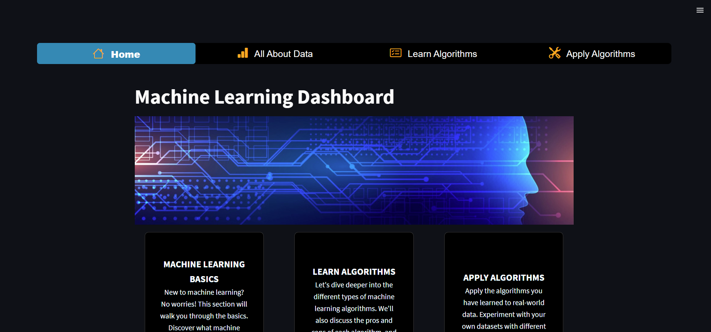
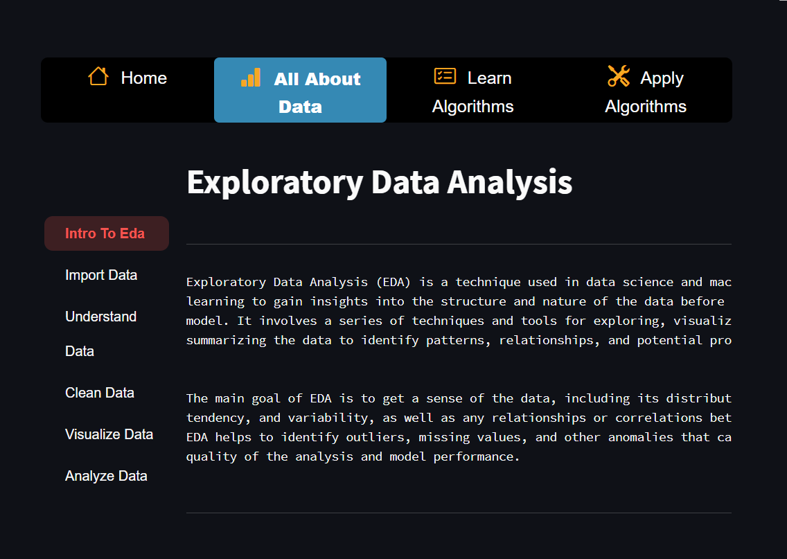
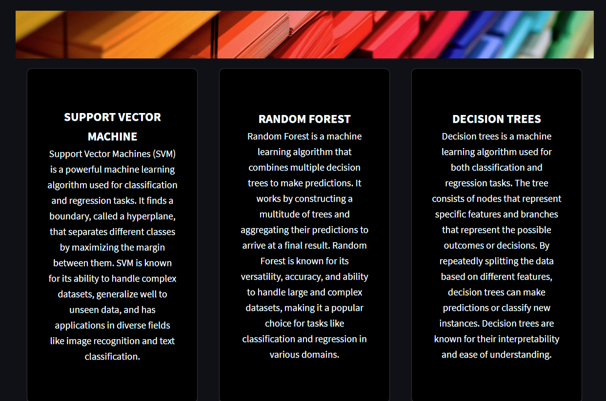
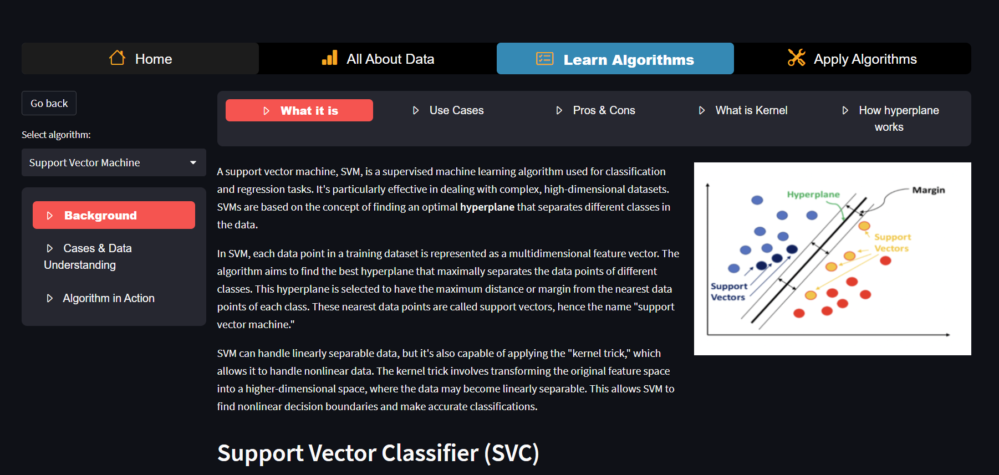
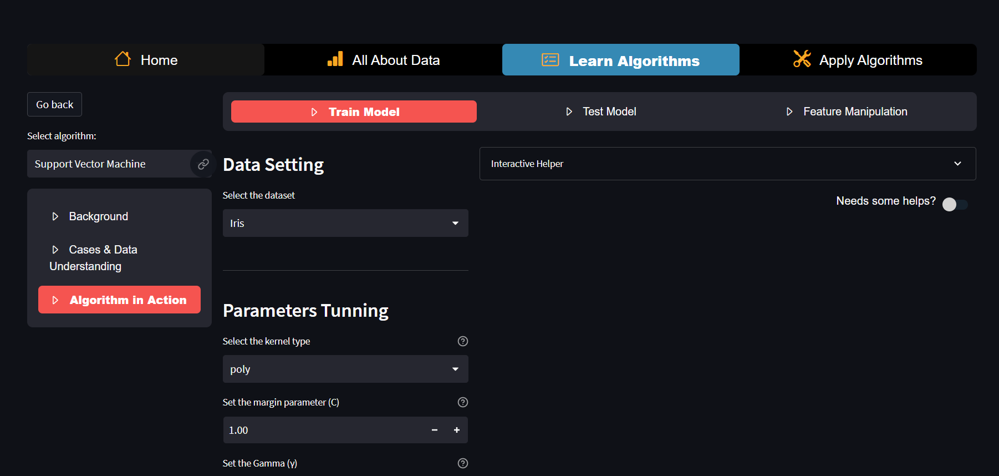
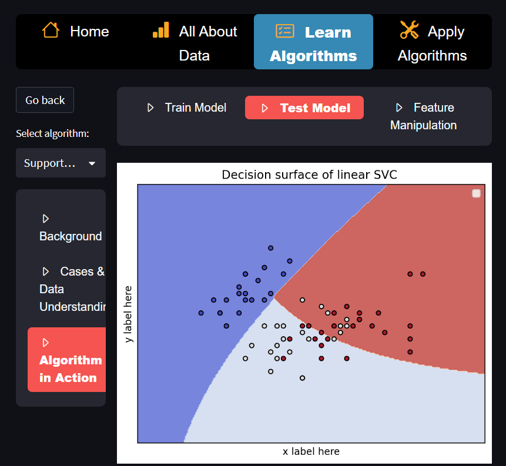
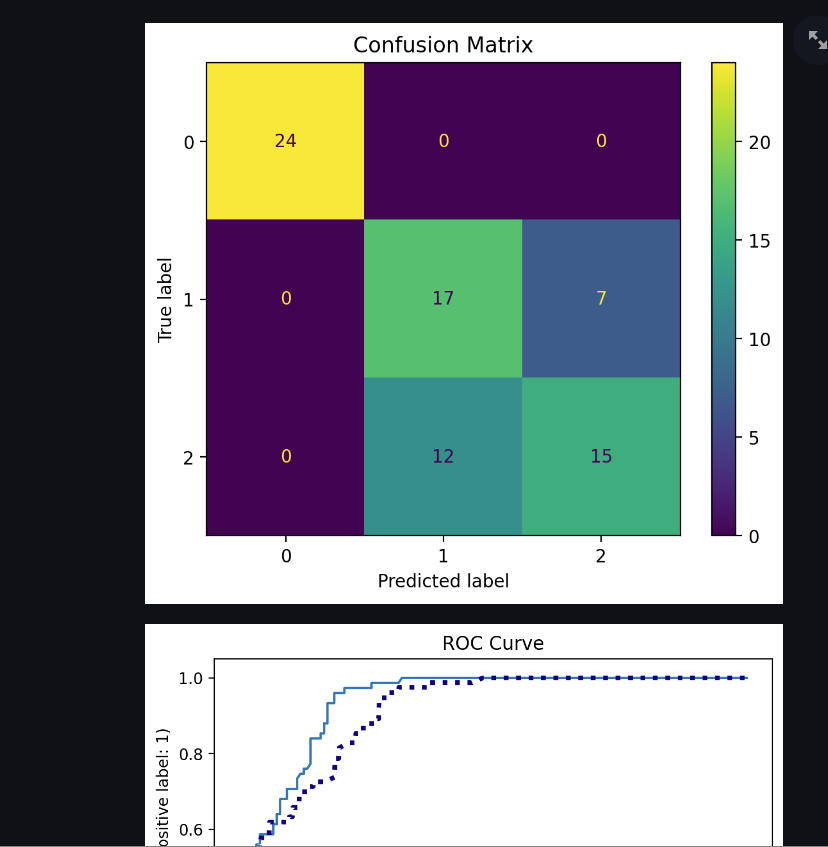

# EducativeMLDashboard

Developer: Jiacheng (Jackie) Chen, Runjie (RJ) Lyu, Macarious Kin Fung Hui, Victor Wu, Yaqi Lyu, Xiaolai (Sean) Chen

Instructor: Dr. Mona Ali, Associate Teaching Professor, Northeastern University Vancouver Campus

This web application is under active developement. Machine Learning background, EDA, SVM learning demo is online.

## Please use the url link to access the deployed web application.

https://jackie-educative-machine-learning-dashboard.streamlit.app/

## Or run the code on your own machine, please use the following commands
```
python3 -m pip install -r requirements.txt
python3 -m streamlit run main.py
```

## Running Tests
To run the automated unit test suite:
```
pytest
```

## Modules

### Current Imported Modules
1. streamlit

    https://streamlit.io/
2. streamlit_option_menu

    github: https://github.com/victoryhb/streamlit-option-menu
3. streamlit-extras

    github: https://github.com/arnaudmiribel/streamlit-extras

    demo: https://extras.streamlit.app/
4. streamlit_antd_components

    github: https://github.com/nicedouble/StreamlitAntdComponents

    demo: https://nicedouble-streamlitantdcomponentsdemo-app-middmy.streamlit.app/
5. numpy

   https://numpy.org/
6. pandas

   https://pandas.pydata.org/
7. matplotlib

   https://matplotlib.org/
8. sklearn

   https://scikit-learn.org/stable/

### Features

- **Home**: Overview of machine learning concepts and navigation to key modules.
- **All About Data (EDA)**: Dataset selection, summary statistics, data cleaning, visualization, and exploratory analysis.
- **Learn Algorithms**: Educational interactive walk-throughs for machine learning algorithms.
- **Apply Algorithms**: Interactive training and testing interface for individual machine learning models.
- **Model Comparison**: Interactive comparison page evaluating **Logistic Regression**, **Decision Tree**, and **Random Forest** models:
  - Supports preset datasets (Iris, Wine, Breast Cancer, Titanic) or active EDA datasets.
  - Leak-free preprocessing pipeline fitted exclusively on training data (handles numerical scaling and categorical one-hot encoding).
  - Handles missing values and incompatible datasets gracefully with informative feedback.
  - Displays Accuracy, Precision, Recall, and F1-Score in a comparative summary table.
  - Renders a grouped bar chart comparison and model-specific confusion matrices.

## App Gallery
### Home page



### Exploratory Data Analysis



### Main page of Learning Algorithms



### SVM Background



### Learn SVM in preset datasets



### Graphing



### More graphing

